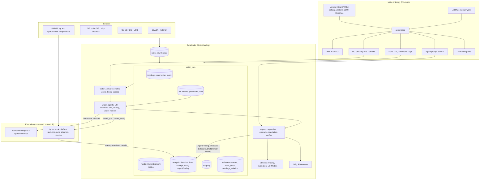
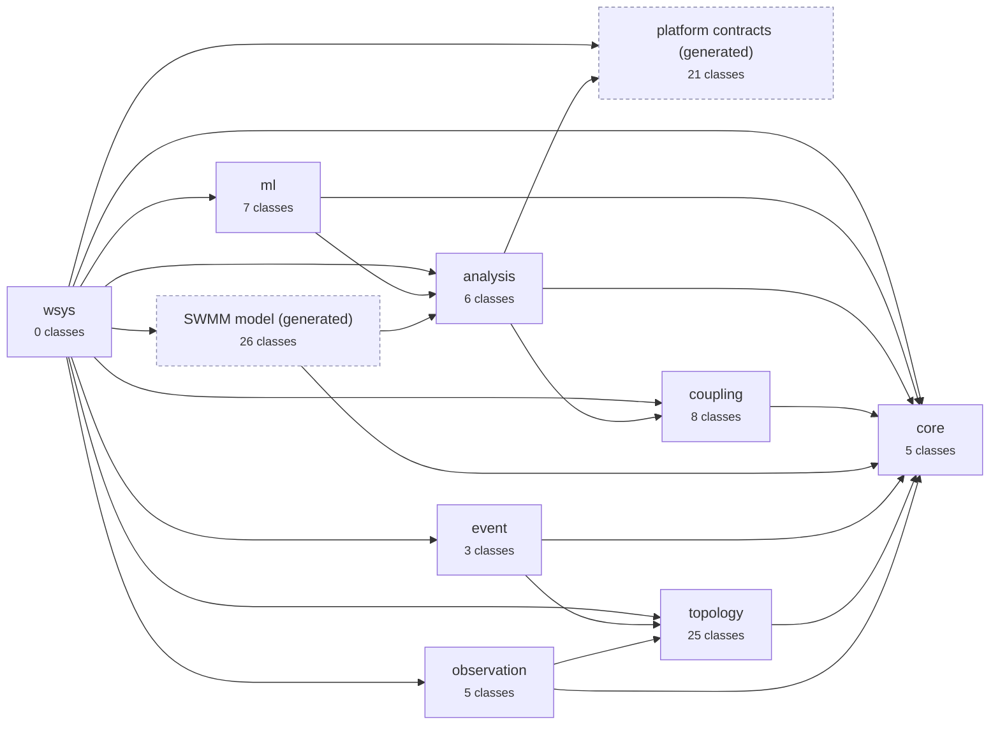

# water-ontology

LinkML source of truth for the water-systems ontology that backs the Databricks
data model, Unity Catalog semantic layer, and agent tool registry.

**One source, many targets.** `schema/*.yaml` is edited by people. Everything
else is generated: OWL and SHACL for reasoning and validation, Delta DDL and
Unity Catalog comments/tags/glossary for the physical model, prompt context
for agents, and the `wsys:model` element vocabulary from `openswmm.engine`'s
API catalog.

## How it fits together



Full write-up, the knowledge-graph views and per-module class diagrams: **[docs](docs/index.md)** (published with mkdocs on GitHub Pages). Figures under `docs/diagrams/` are generated from the schema by `make diagrams`; CI fails if they are stale.

## Modules



## Layout

| Path | What |
| --- | --- |
| `schema/provenance.yaml` | PROV-O agents (`Agent`: person, organisation, service principal, AI agent, ML model, software), `Attributed` / `Activity` / `Dataset` mixins carrying `prov:*`, `dcterms:*` and `dcat:distribution`; applied to revisions, runs, attempts, studies, findings, model versions, training data, datastreams |
| `schema/core.yaml` | Entity, SpatialEntity, Asset, DerivedEntity; lifecycle and provenance slots; shared prefixes |
| `schema/topology.yaml` | SWMM-first: Junction, Outfall, Divider, StorageUnit, LIDControl, Conduit, Street, Pump, Orifice, Weir, Outlet, Inlet, RainGage, Subcatchment, LandUse, Aquifer, Mesh2D/Cell2D, Terminal, Structure, Zone; Edge (one directed graph: CONNECTS_TO, DRAINS_TO, CAPTURES_TO, USES_GAGE, CONTAINED_IN, ATTACHED_TO, BELONGS_TO_ZONE, REPRESENTED_BY, COUPLED_TO ...) |
| `schema/distribution.yaml` | Pipe, Tank, Valve, Hydrant, ServiceConnection, Meter (stub; not in the release root until distribution is in scope) |
| `schema/observation.yaml` | SOSA-aligned: Sensor, ObservedProperty, Datastream, Observation (measurement, forecast, simulation, aggregate in one shape), Setpoint; quality flags and staleness |
| `schema/event.yaml` | Event (type, source, severity, occurred/detected/reported/ended, lifecycle state), EventLink (affects, evidence, cause, resolution), EventStateChange (PROV per transition) |
| `schema/model.yaml` | **Generated** from `openswmm.engine.catalog` by `make model`; do not edit. `model.lock.json` pins the catalog revision and hash |
| `schema/mappings/swmm_to_wsys.yaml` | Hand-curated: which `wsys:` topology class each generated `Swmm*` class means |
| `schema/analysis_platform.yaml` | **Generated** from hydrocouple.platform JSON Schemas by `make platform`: `Platform*` contract classes (revision manifest, run request, job spec, attempt manifest, study view, event, error) with `$defs` inlined |
| `schema/analysis.yaml` | Curated: `Revision`, `Run`, `Attempt`, `Study`, `Candidate`, `AgentFinding`; each embeds its platform contract as a manifest and adds wsys identity and PROV |
| `schema/coupling.yaml` | HydroCouple: `ModelComponent`, `ComponentArgument`, `ExchangeItem` → `Input` / `Output` / `AdaptedOutput`, `Composition`, `ComponentConnection` |
| `schema/wsys.yaml` | Release root that imports every module; build targets point here |
| `generators/` | LinkML → Delta DDL + UC metadata, catalog → LinkML, LinkML → prompt |
| `vendor/` | Pinned copies of the inputs the generators read: `openswmm/catalog.json` and `hydrocouple.platform/schemas/*.json`, each with a `SOURCE.yaml` naming repo, branch and commit; refresh with `make update-vendor` |
| `imports/` | Pinned copies of SAREF4WATR, SOSA, PROV-O for mapping checks |
| `tests/` | Lint, SHACL over fixtures, catalog round-trip |
| `dist/` | Build output (gitignored) |

## Build

```bash
source ./activate.sh     # venv on PATH; caches kept inside the repo
make                     # model-check + platform-check + lint + owl + shacl + sql + delta + diagrams
make docs-serve          # browse the docs locally (pip install -e '.[docs]')
make update-vendor       # copy catalog.json and platform schemas from sibling checkouts, record their commits, regenerate
make model platform      # regenerate the generated modules from vendor/ (CATALOG= / PLATFORM_SCHEMAS= to override)
make delta               # Delta DDL + Unity Catalog metadata into dist/delta
make test
```

## Conventions

- Class and slot `description`s are written for an LLM reader; they become Unity Catalog comments and glossary definitions verbatim.
- Enum values are UPPER_SNAKE so they survive into SQL unchanged; each enum becomes a `reference.*` table.
- Every numeric slot carries a `unit` (UCUM); the Delta generator maps it to a QUDT IRI.
- Keep the class tree shallow (Esri Utility Network lesson): variants are attributes, not subclasses.
- Connectivity is never stored on an asset; it is an `Edge` row.
- Breaking changes (rename/remove) need a script in `migrations/` or CI fails.

## Generated model layer

`generators/catalog_to_linkml.py` reads the OpenSWMM API catalog and emits `schema/model.yaml`:

- element kinds (`node`, `link`, `subcatchment`, `gage`, `pollutant`, ...) become `Swmm*` classes under `SwmmElement` (an `Entity` keyed by `revision` + `element_id`);
- subtype views (`node.outfall`, `link.orifice`, ...) become subclasses, and `NodeType`/`LinkType` codes without a view (`JUNCTION`, `CONDUIT`) still get a class;
- component views (`node.stats`, `link.xsect`, `subcatchment.infiltration`) become inlined classes, which the Delta generator renders as `STRUCT` columns;
- keyed item views (`subcatchment.coverage`, `loadings`) become keyed-map attributes;
- properties become attributes with `catalog_path`, `access`, `c_symbols`, `unit_kind` and `python_type` annotations, which the Delta generator turns into column tags; read-only engine results are marked `readonly`;
- referenced enums are copied verbatim; methods and services are behaviour and are only listed in the module annotations.

`make model-check` (and `tests/test_model_catalog.py`) fail when the catalog moves and `model.yaml` was not regenerated.

## ML module (`schema/ml.yaml`)

Models are governed assets with meaning: `MLModel` (task, target `FeatureBinding`, applies-to class and scope) →
`MLModelVersion` (framework SKLEARN / PYTORCH / LIGHTNING / ..., MLflow run and `models:/` URI, UC alias, `inputs`
as FeatureBindings, `TrainingDataset`, metrics vs baseline, stage) → `Prediction` (entity, property, valid time,
interval or probability, inputs used, out-of-scope flag) and `DriftCheck`. `FeatureBinding` ties each signature
column to an ontology class and property with aggregation, window, lag and the edge relations walked to reach it.

## Esri Utility Network (`schema/mappings/esri_un_to_wsys.yaml`)

UN is the asset register; SWMM is the hydraulic model. The mapping file says which wsys class each UN feature
class / Asset Group / Asset Type becomes, which `EdgeRelation` each association type is, how terminals, network
attributes, lifecycle codes and subnetwork tiers map, and that UN rules generate SHACL shapes. Assets are linked to
their `SwmmElement` by `REPRESENTED_BY` edges produced by a reconciliation job.

## Ontological frameworks

| Framework | Role | How it appears |
| --- | --- | --- |
| **PROV-O** | Lineage: what was derived from what, by which activity, attributed to which agent | `DerivedEntity` (`wasDerivedFrom`, `wasGeneratedBy`); `Activity` mixin (`wasAssociatedWith`, `used`, `startedAtTime`); `Attributed` mixin (`wasAttributedTo`); `Agent` class with `actedOnBehalfOf` |
| **Dublin Core (dcterms)** | Description: title, created/modified, creator, publisher, license, conformsTo, rights | Schema headers (`license`, `created_by`, `source`) and `dc_*` slots on dataset-like classes |
| **DCAT** | Discoverability: datasets and their distributions | `Dataset` mixin with `Distribution` (access URL, media type, checksum, Delta version) on `Revision`, `Attempt`, `TrainingDataset`, `MLModelVersion`, `Datastream` |
| SOSA/SSN, OWL-Time, SEM, QUDT, GeoSPARQL, SKOS, SAREF4WATR, ML-Schema, HydroCouple | Domain vocabularies | `exact_mappings` / `slot_uri` throughout; see each module |

## Validation

Two layers, both generated:

- **SHACL** (`dist/wsys.shacl.ttl`): per-node checks - required slots, enum values, datatypes, closed shapes. `tests/fixtures/` holds a valid mini-network and invalid variants; `tests/test_shacl.py` asserts each fails for the intended reason.
- **SQL assertions** (`dist/assertions/`, from `generators/linkml_to_assertions.py`): cross-row rules that need joins - edge endpoints exist, each relation only connects the classes `edge_domains.yaml` allows, every link has one upstream and one downstream node, subcatchments drain somewhere, sensors are attached, resolved events have a resolution, AI agents never confirm events, predictions target the model's class, one champion per model. Each rule is a view `reference.v_violation_<rule>`; `99_refresh_violations.sql` rebuilds `reference.ontology_violation`. See [docs/rules.md](docs/rules.md).
