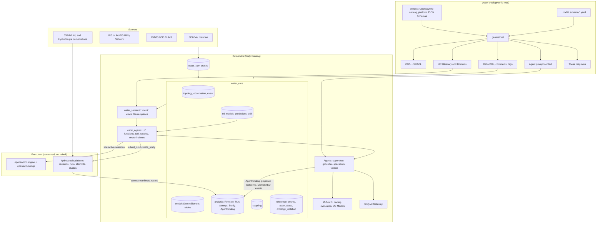
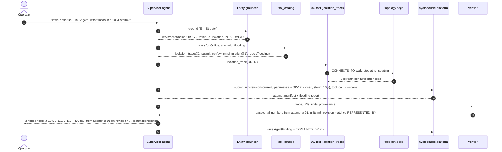

# How it fits together

The ontology is the one place meaning is written down. Everything the agents touch on Databricks — tables, comments, glossary, tool contracts, prompt context — is generated from it, and everything the agents produce — findings, predictions, events — is written back in its terms. The simulation engine and the execution platform are consumed, not rebuilt.

## From source systems to agents

## How a question travels

## Where each kind of knowledge lives

| Knowledge | Lives in | Reaches agents through |
| --- | --- | --- |
| What things are, how they relate, units, constraints | `schema/*.yaml` | Column comments and tags, glossary, `describe_ontology` tool, prompt context |
| What exists and how it is connected | `topology.*` tables and `topology.edge` | Lookup and traversal UC functions |
| How the system behaves | SWMM model elements (`model.*`) in a `Revision`; the engine | openswmm.mcp sessions; platform runs via `submit_run` |
| What is happening | `observation.*`, `event.*` | Time-series and event tools; `EVIDENCE_FOR` links |
| What was computed and why | `analysis.*` (attempt manifests with provenance), `ml.prediction` | Every answer cites attempt, model version, table version |
| What is allowed | `water_agents.tool_catalog`, Unity Catalog grants, AI Gateway, platform budgets | The agent can only call what is `active`; proposals need human approval |

## Reading the generated figures

- [Module map](diagrams/modules.md) — which schema files import which.
- [Knowledge graph](diagrams/knowledge-graph.md) — classes and the relations between them, in four focused views plus the full graph.
- [Relations](diagrams/relations.md) — allowed from/to classes per `EdgeRelation` and `EventLinkRelation`.
- Per-module class diagrams: [core](diagrams/core.md), [topology](diagrams/topology.md), [observation](diagrams/observation.md), [event](diagrams/event.md), [coupling](diagrams/coupling.md), [analysis](diagrams/analysis.md), [platform contracts](diagrams/analysis-platform.md), [SWMM model](diagrams/model.md), [ml](diagrams/ml.md).
