# platform contracts (generated)

GENERATED from hydrocouple.platform JSON Schemas by generators/platform_to_linkml.py; do not edit. Top-level contracts become Platform* classes, $defs become inlined component classes. The curated analysis module (schema/analysis.yaml) embeds these as manifests.

```mermaid
classDiagram
  class PlatformActor {
    string agent_client
    string agent_client_version
    string agent_session_id
    string conversation_ref
    string human_subject*
    string model
    string tool_call_id
  }
  class PlatformArtifactEntry {
    string format*
    ArtifactKind kind*
    string path*
    string sha256*
    integer size*
  }
  class PlatformAttemptManifest {
    PlatformArtifactEntry artifacts*
    PlatformProvenance provenance*
    string quality
    string run_manifest
    string run_manifest_sha256*
    string schema
    PlatformAttemptManifestStatus platform_status*
  }
  class PlatformError {
    ErrorCode code*
    string details
    string message*
    string next_action
    boolean retryable
  }
  class PlatformEvent {
    float agent_clock_seconds
    float completed
    string event_id*
    EventKind kind*
    string message
    datetime occurred_at*
    string phase
    integer sequence*
    float total
    string platform_unit
  }
  class PlatformInputFile {
    string path*
    string sha256*
    integer size*
  }
  class PlatformInputs {
    string composition
    PlatformInputFile files*
    string manifest_sha256*
    string revision_id*
    string storage_prefix*
  }
  class PlatformJobSpec {
    PlatformActor actor*
    PlatformInputs inputs*
    string job_id*
    PlatformLimits limits*
    string organization_id*
    PlatformOutputs outputs*
    PlatformPlacement placement*
    string project_id*
    string recovery
    PlatformResources resources*
    string run_id*
    PlatformRuntime runtime*
    string spec_version
    PlatformWorkload workload*
  }
  class PlatformLimits {
    float estimated_runtime_seconds
    integer execution_timeout_seconds
    integer queue_deadline_seconds
    integer retry_budget
  }
  class PlatformManifestFile {
    string path*
    FileRole role*
    string sha256*
    integer size*
    string source
  }
  class PlatformObjective {
    PlatformObjectiveDirection direction*
    string name*
  }
  class PlatformOutputs {
    EgressPolicy egress_policy
    string required_artifacts*
    integer retention_days
    string storage_prefix*
  }
  class PlatformPlacement {
    PlatformPlacementInterruption interruption
    string target_id*
  }
  class PlatformProvenance {
    PlatformActor actor*
    string attempt_id*
    integer attempt_number*
    string composition_sha256*
    datetime finished_at*
    string inputs*
    string job_id*
    string parameters*
    string profile
    string revision_id*
    string revision_manifest_sha256*
    string run_id*
    PlatformRuntimeVersions runtime*
    string seeds
    ... 4 more
  }
  class PlatformResources {
    float cpu
    string gpu
    JobClass job_class
    float memory_gib
    integer pool_size
    string profile
    integer ranks
    float scratch_gib
  }
  class PlatformRevisionManifest {
    string components*
    string composition
    datetime created_at*
    PlatformManifestFile files*
    string findings
    string packaged_by*
    string schema
    integer total_bytes*
  }
  class PlatformRunRequest {
    float estimated_runtime_seconds
    string parameters
    string profile
    string project_id*
    integer retry_budget
    string revision_id*
    string session_id
    string target_id*
    string tool_call_id
    string workflow*
    string workflow_version*
  }
  class PlatformRuntime {
    string architecture
    string image
    integer threads
  }
  class PlatformRuntimeVersions {
    string engine
    string host
    string image
    string platform*
    string python*
  }
  class PlatformStudyView {
    string approval_id
    integer batches*
    datetime created_at*
    integer dimensions*
    integer evaluations_completed*
    integer evaluations_failed*
    integer evaluations_submitted*
    string failure
    integer max_evaluations*
    string next_action
    PlatformObjective objectives*
    FailurePolicy on_failure*
    string pool
    integer pool_size*
    ... 11 more
  }
  class PlatformWorkload {
    string parameters
    string workflow*
    string workflow_version*
  }
  PlatformAttemptManifest *-- "*" PlatformArtifactEntry : artifacts
  PlatformAttemptManifest *-- "1" PlatformProvenance : provenance
  PlatformInputs *-- "*" PlatformInputFile : files
  PlatformJobSpec *-- "1" PlatformActor : actor
  PlatformJobSpec *-- "1" PlatformInputs : inputs
  PlatformJobSpec *-- "1" PlatformLimits : limits
  PlatformJobSpec *-- "1" PlatformOutputs : outputs
  PlatformJobSpec *-- "1" PlatformPlacement : placement
  PlatformJobSpec *-- "1" PlatformResources : resources
  PlatformJobSpec *-- "1" PlatformRuntime : runtime
  PlatformJobSpec *-- "1" PlatformWorkload : workload
  PlatformProvenance *-- "1" PlatformActor : actor
  PlatformProvenance *-- "1" PlatformRuntimeVersions : runtime
  PlatformRevisionManifest *-- "*" PlatformManifestFile : files
  PlatformStudyView *-- "*" PlatformObjective : objectives
```

## Classes

| Class | Parent | Description |
| --- | --- | --- |
| `PlatformActor` |  | Who asked for the work: the human principal and, optionally, an AI agent. |
| `PlatformArtifactEntry` |  | ArtifactEntry |
| `PlatformAttemptManifest` |  | AttemptManifest |
| `PlatformError` |  | ErrorBody |
| `PlatformEvent` |  | Event |
| `PlatformInputFile` |  | InputFile |
| `PlatformInputs` |  | Inputs |
| `PlatformJobSpec` |  | JobSpec |
| `PlatformLimits` |  | Limits |
| `PlatformManifestFile` |  | ManifestFile |
| `PlatformObjective` |  | Objective |
| `PlatformOutputs` |  | Outputs |
| `PlatformPlacement` |  | Placement |
| `PlatformProvenance` |  | Execution provenance; ``to_prov`` renders it in W3C PROV-JSON terms. |
| `PlatformResources` |  | Resources |
| `PlatformRevisionManifest` |  | RevisionManifest |
| `PlatformRunRequest` |  | RunRequest |
| `PlatformRuntime` |  | Runtime |
| `PlatformRuntimeVersions` |  | RuntimeVersions |
| `PlatformStudyView` |  | StudyView |
| `PlatformWorkload` |  | Workload |
