# platform contracts (generated)

GENERATED from hydrocouple.platform JSON Schemas by generators/platform_to_linkml.py; do not edit. Top-level contracts become Platform* classes, $defs become inlined component classes. The curated analysis module (schema/analysis.yaml) embeds these as manifests.

```mermaid
classDiagram
  class PlatformActor {
    string agent_client
    string agent_client_version
    string agent_session_id
    string conversation_ref
    string human_subject*
    string model
    string tool_call_id
  }
  class PlatformAgentSessionView {
    string agent_session_id*
    PlatformBudget budget*
    datetime expires_at*
    string remaining
    string used
  }
  class PlatformApprovalView {
    string approval_id*
    datetime expires_at*
    string job_id
    string reasons*
    string run_id
    string study_id
  }
  class PlatformArtifactEntry {
    string format*
    ArtifactKind kind*
    string path*
    string sha256*
    integer size*
  }
  class PlatformArtifactInput {
    string attempt_id*
    string key*
    string path*
    string role
    string run_id*
    string sha256*
    integer size*
    string source_path*
  }
  class PlatformAttemptManifest {
    PlatformArtifactEntry artifacts*
    PlatformProvenance provenance*
    string quality
    string run_manifest
    string run_manifest_sha256*
    string schema
    PlatformAttemptManifestStatus platform_status*
  }
  class PlatformBudget {
    JobClass allowed_job_classes
    string allowed_targets
    integer max_concurrent_attempts
    float max_estimated_spend
    integer max_evaluations
    integer max_runs
    integer max_wall_time_seconds
  }
  class PlatformComponentInstance {
    string component_info_id*
    string id*
    string model*
    string role*
  }
  class PlatformComponentRecord {
    string component_info_id*
    string final_status*
    string id*
    string qualification*
    string role*
  }
  class PlatformDerivedFrom {
    string decisions
    integer evaluation
    string revision_id*
    string revision_manifest_sha256*
    string study_id
  }
  class PlatformError {
    ErrorCode code*
    string details
    string message*
    string next_action
    boolean retryable
  }
  class PlatformEvent {
    float agent_clock_seconds
    float completed
    string event_id*
    EventKind kind*
    string message
    datetime occurred_at*
    string phase
    integer sequence*
    float total
    string platform_unit
  }
  class PlatformInputFile {
    string path*
    string sha256*
    integer size*
  }
  class PlatformInputs {
    PlatformArtifactInput artifacts
    string composition
    PlatformInputFile files*
    string manifest_sha256*
    string revision_id*
    string storage_prefix*
  }
  class PlatformJobSpec {
    PlatformActor actor*
    PlatformInputs inputs*
    string job_id*
    PlatformLimits limits*
    string organization_id*
    PlatformOutputs outputs*
    PlatformPlacement placement*
    string project_id*
    string recovery
    PlatformResources resources*
    string run_id*
    PlatformRuntime runtime*
    string spec_version
    PlatformWorkload workload*
  }
  class PlatformLimits {
    float estimated_runtime_seconds
    integer execution_timeout_seconds
    integer queue_deadline_seconds
    integer retry_budget
  }
  class PlatformManifestFile {
    string path*
    FileRole role*
    string sha256*
    integer size*
    string source
  }
  class PlatformObjective {
    PlatformObjectiveDirection direction*
    string name*
  }
  class PlatformOutputs {
    EgressPolicy egress_policy
    string required_artifacts*
    integer retention_days
    string storage_prefix*
  }
  class PlatformPlacement {
    PlatformPlacementInterruption interruption
    string target_id*
  }
  class PlatformProposalView {
    datetime applied_at*
    string applied_run_id*
    datetime created_at*
    datetime decided_at*
    string decided_by*
    string decision_note*
    datetime effective_from*
    datetime issued_at*
    string link*
    string note*
    string property*
    string proposal_id*
    string proposed_by*
    string run_id*
    ... 3 more
  }
  class PlatformProvenance {
    PlatformActor actor*
    string attempt_id*
    integer attempt_number*
    PlatformComponentRecord components
    string composition_sha256*
    datetime finished_at*
    string inputs*
    string job_id*
    string parameters*
    string profile
    PlatformResumedFrom resumed_from
    string revision_id*
    string revision_manifest_sha256*
    string run_id*
    ... 6 more
  }
  class PlatformResources {
    float cpu
    string gpu
    JobClass job_class
    float memory_gib
    integer pool_size
    string profile
    integer ranks
    float scratch_gib
  }
  class PlatformResumedFrom {
    string attempt_id*
    string path*
    string run_id*
    string sha256*
  }
  class PlatformRevisionManifest {
    PlatformComponentInstance component_instances
    string components*
    string composition
    datetime created_at*
    PlatformDerivedFrom derived_from
    PlatformManifestFile files*
    string findings
    string packaged_by*
    string schema
    integer total_bytes*
  }
  class PlatformRunRequest {
    string estimate_id
    float estimated_runtime_seconds
    string parameters
    string profile
    string project_id*
    string resume_from
    integer retry_budget
    string revision_id*
    string session_id
    string target_id*
    string tool_call_id
    string workflow*
    string workflow_version*
  }
  class PlatformRunSummary {
    string engine
    string flow_units
    string schema
    string tables*
    string unit_system
  }
  class PlatformRuntime {
    string architecture
    string host
    string image
    integer threads
  }
  class PlatformRuntimeVersions {
    string engine
    string host
    string image
    string platform*
    string python*
  }
  class PlatformScheduleCycleView {
    integer attempt*
    datetime cycle_end*
    string job_id*
    string job_state*
    integer number*
    string resumed_from*
    string run_id*
  }
  class PlatformScheduleView {
    string agent_session_id*
    boolean await_decisions*
    datetime created_at*
    float cycle_minutes*
    integer cycles*
    datetime first_cycle_end*
    PlatformScheduleCycleView history*
    float lag_seconds*
    string last_run_id*
    integer next_cycle*
    Pace pace*
    string parameters*
    string pause_reason*
    string project_id*
    ... 7 more
  }
  class PlatformStudyDefinition {
    PlatformStudyDimension dimensions*
    string env_config*
    string model_inputs*
    PlatformObjective objectives*
    string optimization*
    integer seed
    string workflow*
    string workflow_version*
  }
  class PlatformStudyDimension {
    float choices
    float high*
    string key*
    string platform_label*
    float low*
  }
  class PlatformStudyEvaluation {
    string decisions*
    string error
    integer evaluation*
    boolean failed
    string metrics
    string objectives*
    integer steps
  }
  class PlatformStudyManifest {
    PlatformStudyDefinition definition*
    PlatformStudyEvaluation evaluations*
    string result*
    string runtime*
    string schema
  }
  class PlatformStudyView {
    string approval_id
    integer batches*
    datetime created_at*
    integer dimensions*
    integer evaluations_completed*
    integer evaluations_failed*
    integer evaluations_submitted*
    string failure
    integer max_evaluations*
    string next_action
    PlatformObjective objectives*
    FailurePolicy on_failure*
    string pool
    integer pool_size*
    ... 11 more
  }
  class PlatformWorkload {
    string parameters
    string workflow*
    string workflow_version*
  }
  PlatformAgentSessionView *-- "1" PlatformBudget : budget
  PlatformAttemptManifest *-- "*" PlatformArtifactEntry : artifacts
  PlatformAttemptManifest *-- "1" PlatformProvenance : provenance
  PlatformInputs *-- "*" PlatformArtifactInput : artifacts
  PlatformInputs *-- "*" PlatformInputFile : files
  PlatformJobSpec *-- "1" PlatformActor : actor
  PlatformJobSpec *-- "1" PlatformInputs : inputs
  PlatformJobSpec *-- "1" PlatformLimits : limits
  PlatformJobSpec *-- "1" PlatformOutputs : outputs
  PlatformJobSpec *-- "1" PlatformPlacement : placement
  PlatformJobSpec *-- "1" PlatformResources : resources
  PlatformJobSpec *-- "1" PlatformRuntime : runtime
  PlatformJobSpec *-- "1" PlatformWorkload : workload
  PlatformProvenance *-- "1" PlatformActor : actor
  PlatformProvenance *-- "*" PlatformComponentRecord : components
  PlatformProvenance *-- "1" PlatformResumedFrom : resumed_from
  PlatformProvenance *-- "1" PlatformRuntimeVersions : runtime
  PlatformRevisionManifest *-- "*" PlatformComponentInstance : component_instances
  PlatformRevisionManifest *-- "1" PlatformDerivedFrom : derived_from
  PlatformRevisionManifest *-- "*" PlatformManifestFile : files
  PlatformScheduleView *-- "*" PlatformScheduleCycleView : history
  PlatformStudyDefinition *-- "*" PlatformStudyDimension : dimensions
  PlatformStudyDefinition *-- "*" PlatformObjective : objectives
  PlatformStudyManifest *-- "1" PlatformStudyDefinition : definition
  PlatformStudyManifest *-- "*" PlatformStudyEvaluation : evaluations
  PlatformStudyView *-- "*" PlatformObjective : objectives
```

## Classes

| Class | Parent | Description |
| --- | --- | --- |
| `PlatformActor` |  | Who asked for the work: the human principal and, optionally, an AI agent. |
| `PlatformAgentSessionView` |  | An agent session as its creator sees it (the credential is returned only once). |
| `PlatformApprovalView` |  | A request outside an agent session's budget, waiting for a person. |
| `PlatformArtifactEntry` |  | ArtifactEntry |
| `PlatformArtifactInput` |  | A file another run published, staged as an input: a twin cycle's previous state. |
| `PlatformAttemptManifest` |  | AttemptManifest |
| `PlatformBudget` |  | A delegated budget for one AI agent session. ``None`` means no limit. |
| `PlatformComponentInstance` |  | One component of a composition of more than the generated single model. |
| `PlatformComponentRecord` |  | A component a composition run ran, and how it ended. |
| `PlatformDerivedFrom` |  | The revision a revision was made from, and the study evaluation that chose it. |
| `PlatformError` |  | ErrorBody |
| `PlatformEvent` |  | Event |
| `PlatformInputFile` |  | InputFile |
| `PlatformInputs` |  | Inputs |
| `PlatformJobSpec` |  | JobSpec |
| `PlatformLimits` |  | Limits |
| `PlatformManifestFile` |  | ManifestFile |
| `PlatformObjective` |  | Objective |
| `PlatformOutputs` |  | Outputs |
| `PlatformPlacement` |  | Placement |
| `PlatformProposalView` |  | ProposalView |
| `PlatformProvenance` |  | Execution provenance; ``to_prov`` renders it in W3C PROV-JSON terms. |
| `PlatformResources` |  | Resources |
| `PlatformResumedFrom` |  | The saved state an attempt resumed from: an artifact of an earlier run's attempt. |
| `PlatformRevisionManifest` |  | RevisionManifest |
| `PlatformRunRequest` |  | RunRequest |
| `PlatformRunSummary` |  | The engine's end-of-run report as data: the tables of the text report.  It names model elements, so it is an artifact in the target's storage and is subject to the target's egress policy; it is never sent in events. |
| `PlatformRuntime` |  | Runtime |
| `PlatformRuntimeVersions` |  | RuntimeVersions |
| `PlatformScheduleCycleView` |  | ScheduleCycleView |
| `PlatformScheduleView` |  | ScheduleView |
| `PlatformStudyDefinition` |  | What a study evaluates and how it searches: the same wherever it runs. |
| `PlatformStudyDimension` |  | One component of the decision vector, with the decision key it belongs to. |
| `PlatformStudyEvaluation` |  | One evaluated candidate, as ``evaluations.jsonl`` records it. |
| `PlatformStudyManifest` |  | A study's definition, every evaluation and its result, written by a local run and by a platform run alike. Two executions of one study differ only in ``runtime``. |
| `PlatformStudyView` |  | StudyView |
| `PlatformWorkload` |  | Workload |
