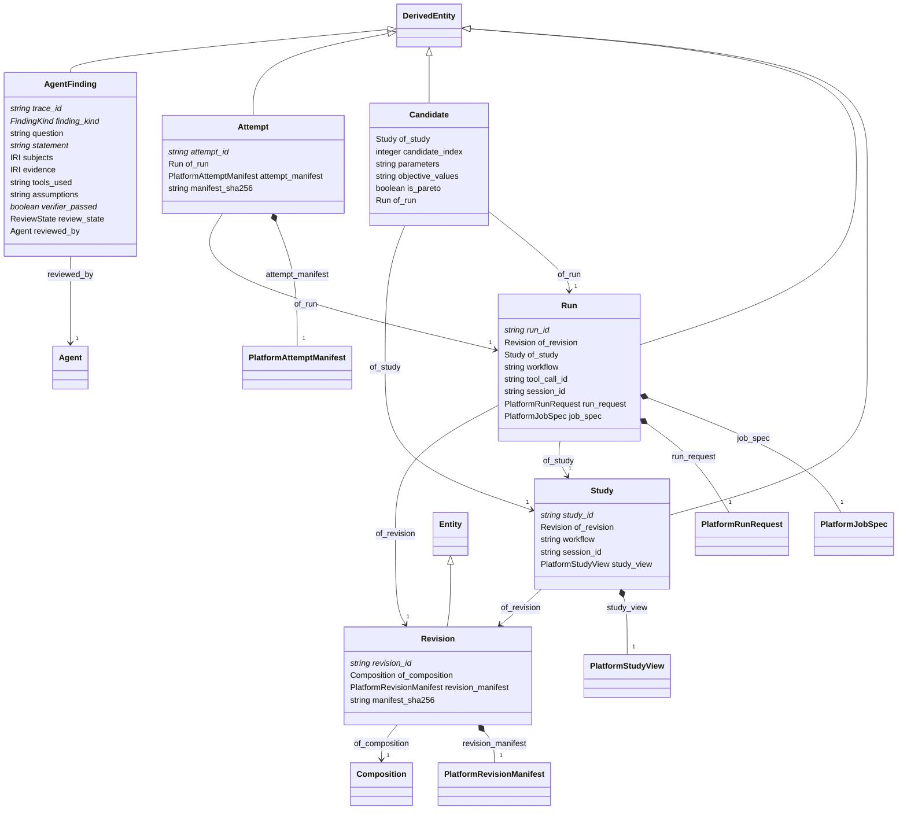

# analysis

Model revisions, runs, attempts, studies and agent findings. Each curated class embeds the matching hydrocouple.platform contract (generated in analysis_platform.yaml) as its manifest, adds wsys identity and PROV links, and is what other modules reference. Nothing here invents a shape the platform does not publish.

## Classes

| Class | Parent | Description |
| --- | --- | --- |
| `AgentFinding` | DerivedEntity | What an agent surfaced to a person, with the trace, tools, evidence and assumptions behind it and the verifier's verdict. Recommendations are proposals only. |
| `Attempt` | DerivedEntity | One execution attempt of a run with its artifacts, provenance and quality (platform attempt manifest). Simulation results ingested as Observations of result_kind SIMULATION point here through was_generated_by. |
| `Candidate` | DerivedEntity | One evaluated design or policy in a study, with its decision variables and objective values. |
| `Revision` | Entity | An immutable packaged composition (files, components, findings) recorded by a hydrocouple.platform revision manifest. Every SwmmElement row belongs to exactly one Revision. |
| `Run` | DerivedEntity | A request to execute a workflow on a revision on a target (platform run request plus the job spec the control plane built from it). |
| `Study` | DerivedEntity | An ask/tell optimisation over an evaluator pool (platform study view): objectives, budget, state and the Pareto set. |
