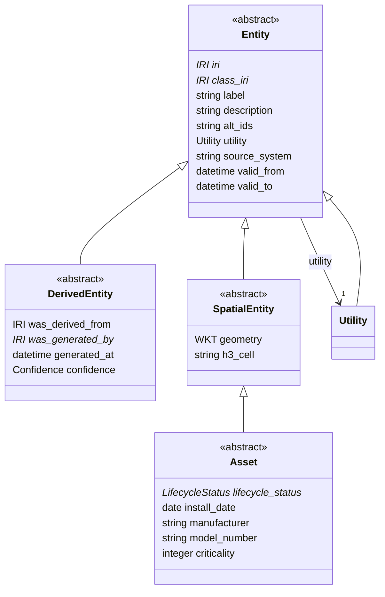

# core

Base classes, identifiers, lifecycle and provenance slots shared by every module. Physical assets, observations, events and analysis artifacts all specialise Entity. The LinkML source here is the single source of truth; OWL, SHACL, Delta DDL and Unity Catalog metadata are generated from it.

## Classes

| Class | Parent | Description |
| --- | --- | --- |
| `Asset` | SpatialEntity | A physical component of a water system that is owned, maintained and can fail. Kept shallow on purpose; variants are attributes, not subclasses. |
| `DerivedEntity` | Entity | Anything produced by a computation, pipeline or agent. Carries PROV links so a reviewer can reproduce it. |
| `Entity` |  | Anything with a stable IRI. Root of the hierarchy. |
| `SpatialEntity` | Entity | An entity with a location or footprint. |
| `Utility` | Entity | A water utility or operating organisation. |
