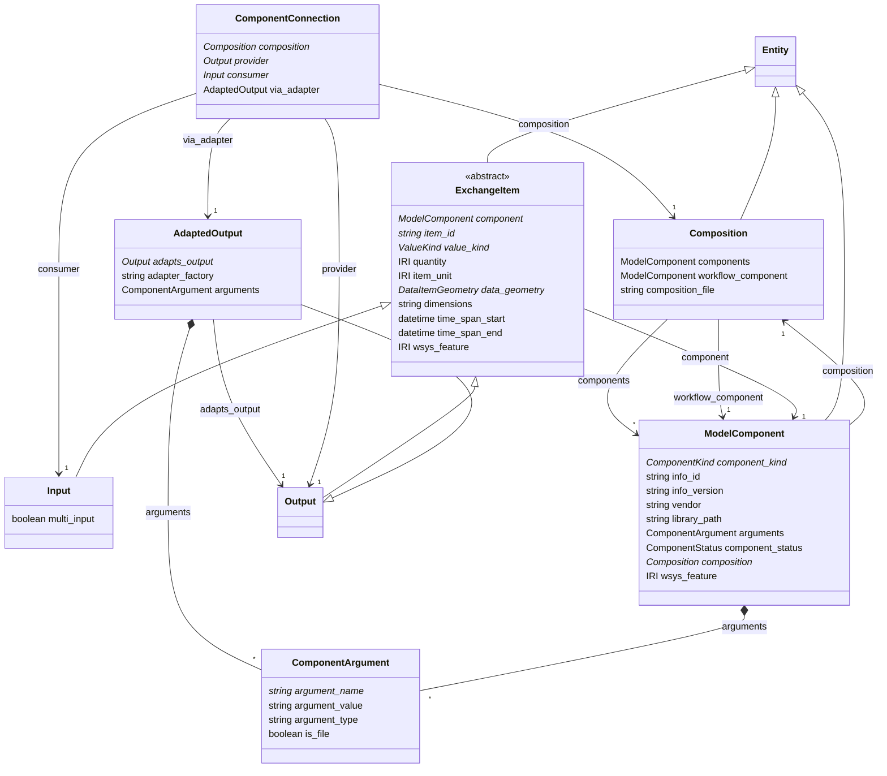

# coupling

Model components, their exchange items and the compositions that couple them, mirroring the HydroCouple SDK interfaces (IModelComponent, IComponentInfo, IArgument, IExchangeItem, IInput, IOutput, IAdaptedOutput, IValueDefinition, IDimension). A Composition is the unit hydrocouple.platform packages into a Revision and runs; a ComponentConnection is a typed link from a provider Output to a consumer Input, optionally through an AdaptedOutput, and is also asserted as a COUPLED_TO Edge for traversal.

## Classes

| Class | Parent | Description |
| --- | --- | --- |
| `AdaptedOutput` | Output | An output transformed in time, space or unit from a provider output by an adapter factory. |
| `ComponentArgument` |  | One IArgument of a component as configured (name, value or file path, type). |
| `ComponentConnection` |  | A typed link from a provider Output to a consumer Input, optionally through an AdaptedOutput. Also written as a COUPLED_TO Edge between the components for traversal. |
| `Composition` | Entity | The set of components and connections run together; what hydrocouple.platform packages into a Revision. A single SWMM .inp is a one-component composition. |
| `ExchangeItem` | Entity | An input or output of a component with its value definition (quantity and unit), dimensions and spatial structure. |
| `Input` | ExchangeItem | A consumer of values. |
| `ModelComponent` | Entity | A configured instance of a HydroCouple model component inside a composition - a SWMM model, a 2D mesh, a data reader, an adapter factory or a workflow. |
| `Output` | ExchangeItem | A provider of values. |
