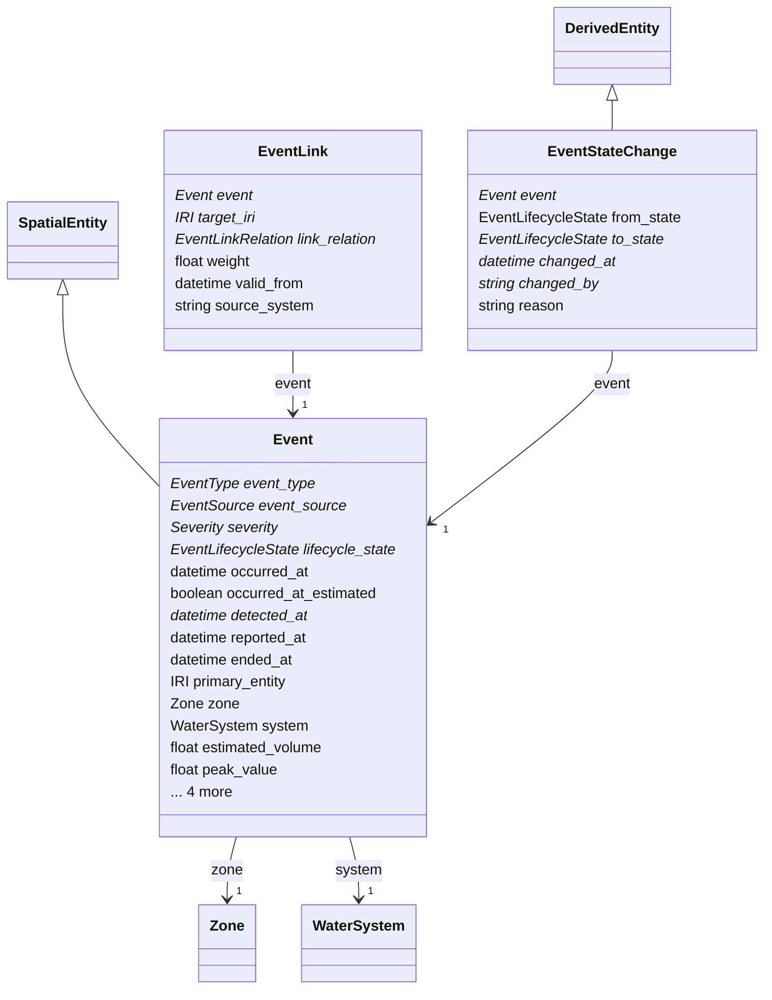

# event

Things that happen to the system: alarms, detected anomalies, flooding, surcharge, CSO/SSO discharges, blockages, water-quality exceedances, customer reports, control actions and maintenance. Each event has a type, a source, separate occurred/detected/reported times, an instant or interval, and a lifecycle state whose transitions carry provenance. Events link to what they affect, their evidence, their causes and their resolution through EventLink rows. Aligned with OWL-Time and the Simple Event Model.

## Classes

| Class | Parent | Description |
| --- | --- | --- |
| `Event` | SpatialEntity | Something that happened to the system. One row per event; evidence, causes, impacts and resolution are EventLink rows; state changes are EventStateChange rows. Agents may create DETECTED events with source AGENT but never CONFIRMED ones. |
| `EventLink` |  | A typed link from an event to an asset, zone, observation, work order, attempt or other event. |
| `EventStateChange` | DerivedEntity | One lifecycle transition of an event with who, when and why; the PROV activity behind every state the event has been in. |
