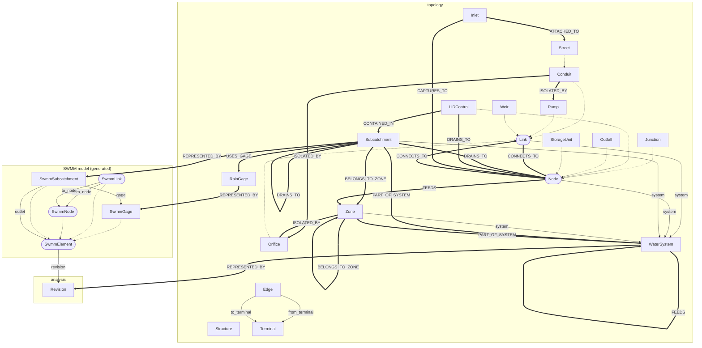
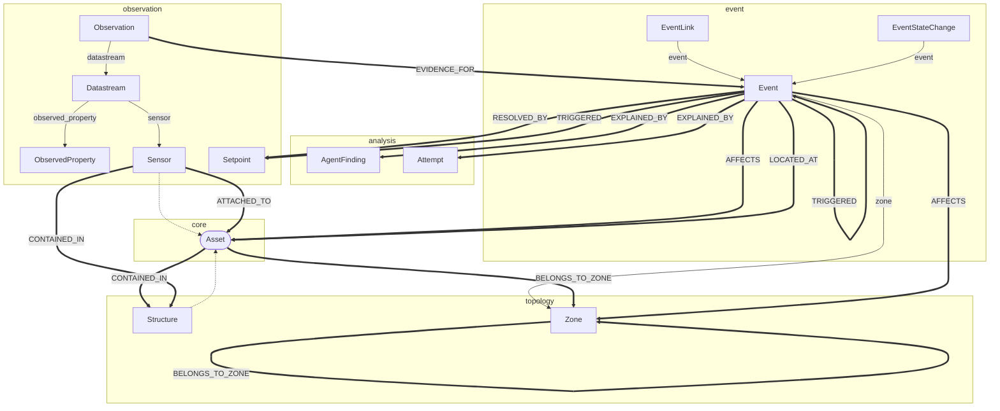
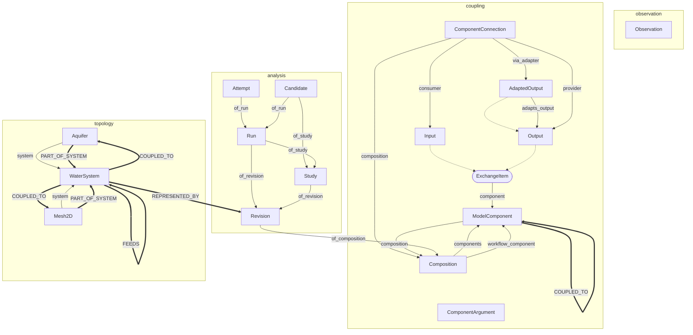
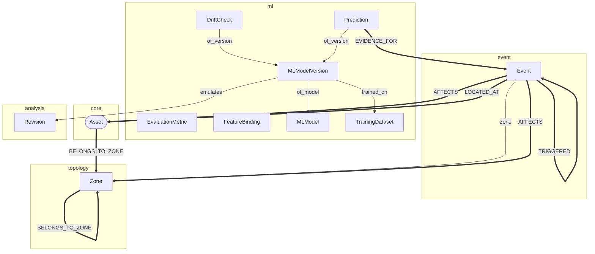

# Knowledge graph

Boxes are classes grouped by module; rounded boxes are abstract. Dashed arrows are `is_a`. Thin labelled arrows are reference slots (a column holding another entity's IRI). Thick arrows are `topology.edge` / `event_link` relations allowed by `edge_domains.yaml`; an abstract class stands for all its subclasses.

## Physical network and its SWMM model

Assets form a directed graph through Edge rows; each asset is REPRESENTED_BY its element in a packaged Revision.

## Telemetry and events around an asset

A Sensor is ATTACHED_TO an asset; its Datastream carries Observations; Observations are EVIDENCE_FOR Events, which AFFECT assets and zones and are EXPLAINED_BY model attempts.

## Simulation lifecycle (HydroCouple and hydrocouple.platform)

A Composition of ModelComponents is packaged as a Revision, executed as Runs and Attempts (or optimised in a Study); simulated values come back as Observations of kind SIMULATION.

## Machine learning

An MLModel's target and inputs are FeatureBindings to ontology classes and properties; each MLModelVersion is trained on a TrainingDataset and produces Predictions about entities, with DriftChecks over time; surrogates emulate a Revision.

## Everything at once

```mermaid
flowchart TB
  subgraph wsys_coupling["coupling"]
    AdaptedOutput["AdaptedOutput"]
    ComponentArgument["ComponentArgument"]
    ComponentConnection["ComponentConnection"]
    Composition["Composition"]
    ExchangeItem(["ExchangeItem"])
    Input["Input"]
    ModelComponent["ModelComponent"]
    Output["Output"]
  end
  subgraph wsys_model["SWMM model (generated)"]
    SwmmElement(["SwmmElement"])
    SwmmGage["SwmmGage"]
    SwmmLink(["SwmmLink"])
    SwmmNode(["SwmmNode"])
    SwmmPollutant["SwmmPollutant"]
    SwmmSubcatchment["SwmmSubcatchment"]
  end
  subgraph wsys_topology["topology"]
    Aquifer["Aquifer"]
    Cell2D["Cell2D"]
    Conduit["Conduit"]
    Divider["Divider"]
    Edge["Edge"]
    Inlet["Inlet"]
    Junction["Junction"]
    LIDControl["LIDControl"]
    LandUse["LandUse"]
    Link(["Link"])
    Mesh2D["Mesh2D"]
    Node(["Node"])
    Orifice["Orifice"]
    Outfall["Outfall"]
    Outlet["Outlet"]
    Pump["Pump"]
    RainGage["RainGage"]
    StorageUnit["StorageUnit"]
    Street["Street"]
    Structure["Structure"]
    Subcatchment["Subcatchment"]
    Terminal["Terminal"]
    WaterSystem["WaterSystem"]
    Weir["Weir"]
    Zone["Zone"]
  end
  subgraph wsys_event["event"]
    Event["Event"]
    EventLink["EventLink"]
    EventStateChange["EventStateChange"]
  end
  subgraph wsys_observation["observation"]
    Datastream["Datastream"]
    Observation["Observation"]
    ObservedProperty["ObservedProperty"]
    Sensor["Sensor"]
    Setpoint["Setpoint"]
  end
  subgraph wsys_ml["ml"]
    DriftCheck["DriftCheck"]
    EvaluationMetric["EvaluationMetric"]
    FeatureBinding["FeatureBinding"]
    MLModel["MLModel"]
    MLModelVersion["MLModelVersion"]
    Prediction["Prediction"]
    TrainingDataset["TrainingDataset"]
  end
  subgraph wsys_analysis["analysis"]
    AgentFinding["AgentFinding"]
    Attempt["Attempt"]
    Candidate["Candidate"]
    Revision["Revision"]
    Run["Run"]
    Study["Study"]
  end
  subgraph wsys_core["core"]
    Asset(["Asset"])
    DerivedEntity(["DerivedEntity"])
    SpatialEntity(["SpatialEntity"])
    Utility["Utility"]
  end
  AdaptedOutput -.-> Output
  AgentFinding -.-> DerivedEntity
  Aquifer -.-> SpatialEntity
  Asset -.-> SpatialEntity
  Attempt -.-> DerivedEntity
  Candidate -.-> DerivedEntity
  Cell2D -.-> SpatialEntity
  Conduit -.-> Link
  Divider -.-> Node
  DriftCheck -.-> DerivedEntity
  Event -.-> SpatialEntity
  EventStateChange -.-> DerivedEntity
  Inlet -.-> Asset
  Input -.-> ExchangeItem
  Junction -.-> Node
  LIDControl -.-> Node
  Link -.-> Asset
  MLModelVersion -.-> DerivedEntity
  Mesh2D -.-> SpatialEntity
  Node -.-> Asset
  Observation -.-> DerivedEntity
  Orifice -.-> Link
  Outfall -.-> Node
  Outlet -.-> Link
  Output -.-> ExchangeItem
  Prediction -.-> DerivedEntity
  Pump -.-> Link
  RainGage -.-> Asset
  Run -.-> DerivedEntity
  Sensor -.-> Asset
  Setpoint -.-> DerivedEntity
  StorageUnit -.-> Node
  Street -.-> Conduit
  Structure -.-> Asset
  Study -.-> DerivedEntity
  Subcatchment -.-> SpatialEntity
  SwmmGage -.-> SwmmElement
  SwmmLink -.-> SwmmElement
  SwmmNode -.-> SwmmElement
  SwmmPollutant -.-> SwmmElement
  SwmmSubcatchment -.-> SwmmElement
  TrainingDataset -.-> DerivedEntity
  Weir -.-> Link
  Zone -.-> SpatialEntity
  AdaptedOutput -- adapts_output --> Output
  Aquifer -- system --> WaterSystem
  Attempt -- of_run --> Run
  Candidate -- of_study --> Study
  Candidate -- of_run --> Run
  Cell2D -- mesh --> Mesh2D
  ComponentConnection -- composition --> Composition
  ComponentConnection -- provider --> Output
  ComponentConnection -- consumer --> Input
  ComponentConnection -- via_adapter --> AdaptedOutput
  Composition -- components --> ModelComponent
  Composition -- workflow_component --> ModelComponent
  Datastream -- sensor --> Sensor
  Datastream -- observed_property --> ObservedProperty
  DriftCheck -- of_version --> MLModelVersion
  Edge -- from_terminal --> Terminal
  Edge -- to_terminal --> Terminal
  Event -- zone --> Zone
  Event -- system --> WaterSystem
  EventLink -- event --> Event
  EventStateChange -- event --> Event
  ExchangeItem -- component --> ModelComponent
  Link -- system --> WaterSystem
  MLModelVersion -- of_model --> MLModel
  MLModelVersion -- trained_on --> TrainingDataset
  MLModelVersion -- emulates --> Revision
  Mesh2D -- system --> WaterSystem
  ModelComponent -- composition --> Composition
  Node -- system --> WaterSystem
  Observation -- datastream --> Datastream
  Prediction -- of_version --> MLModelVersion
  Revision -- of_composition --> Composition
  Run -- of_revision --> Revision
  Run -- of_study --> Study
  Study -- of_revision --> Revision
  Subcatchment -- system --> WaterSystem
  SwmmElement -- revision --> Revision
  SwmmLink -- from_node --> SwmmNode
  SwmmLink -- to_node --> SwmmNode
  SwmmSubcatchment -- gage --> SwmmGage
  SwmmSubcatchment -- outlet --> SwmmElement
  Terminal -- on_device --> Asset
  Zone -- system --> WaterSystem
  Link == CONNECTS_TO ==> Node
  Node == CONNECTS_TO ==> Link
  Subcatchment == DRAINS_TO ==> Node
  Subcatchment == DRAINS_TO ==> Subcatchment
  LIDControl == DRAINS_TO ==> Node
  Inlet == CAPTURES_TO ==> Node
  Subcatchment == USES_GAGE ==> RainGage
  Asset == CONTAINED_IN ==> Structure
  LIDControl == CONTAINED_IN ==> Subcatchment
  Sensor == CONTAINED_IN ==> Structure
  Sensor == ATTACHED_TO ==> Asset
  Inlet == ATTACHED_TO ==> Street
  Asset == BELONGS_TO_ZONE ==> Zone
  Subcatchment == BELONGS_TO_ZONE ==> Zone
  Zone == BELONGS_TO_ZONE ==> Zone
  Node == FEEDS ==> Zone
  WaterSystem == FEEDS ==> WaterSystem
  Conduit == ISOLATED_BY ==> Orifice
  Zone == ISOLATED_BY ==> Orifice
  Conduit == ISOLATED_BY ==> Pump
  Asset == PART_OF_SYSTEM ==> WaterSystem
  Subcatchment == PART_OF_SYSTEM ==> WaterSystem
  Zone == PART_OF_SYSTEM ==> WaterSystem
  Aquifer == PART_OF_SYSTEM ==> WaterSystem
  Mesh2D == PART_OF_SYSTEM ==> WaterSystem
  Asset == REPRESENTED_BY ==> SwmmElement
  Subcatchment == REPRESENTED_BY ==> SwmmSubcatchment
  RainGage == REPRESENTED_BY ==> SwmmGage
  WaterSystem == REPRESENTED_BY ==> Revision
  ModelComponent == COUPLED_TO ==> ModelComponent
  WaterSystem == COUPLED_TO ==> Mesh2D
  WaterSystem == COUPLED_TO ==> Aquifer
  Event == AFFECTS ==> Asset
  Event == AFFECTS ==> Zone
  Event == AFFECTS ==> Cell2D
  Event == LOCATED_AT ==> Asset
  Event == LOCATED_AT ==> Subcatchment
  Observation == EVIDENCE_FOR ==> Event
  Prediction == EVIDENCE_FOR ==> Event
  Event == EVIDENCE_FOR ==> Event
  Event == CAUSED_BY ==> Event
  Event == PART_OF ==> Event
  Event == RESOLVED_BY ==> Setpoint
  Event == TRIGGERED ==> Setpoint
  Event == TRIGGERED ==> Event
  Event == EXPLAINED_BY ==> Attempt
  Event == EXPLAINED_BY ==> AgentFinding
```

Full graph of the curated classes (large)

