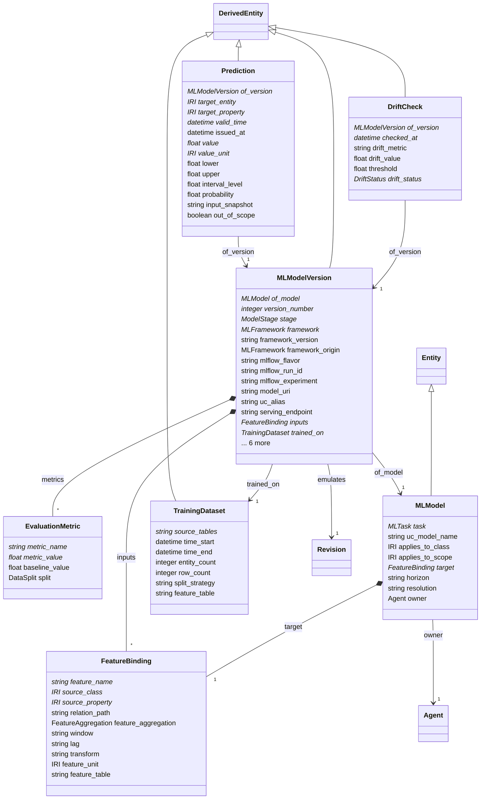

# ml

Machine-learning models as governed, explainable assets. A model's inputs and target are FeatureBindings to ontology classes and properties, so an agent can say in domain terms what a model consumes and predicts, the verifier can check that a model applies to the entity it is being asked about, and every Prediction carries provenance to the exact model version, training data and inputs. The registry of record is MLflow with Unity Catalog Models; this module is the semantic layer over it, not a replacement.

## Classes

| Class | Parent | Description |
| --- | --- | --- |
| `DriftCheck` | DerivedEntity | A scheduled comparison of live inputs or predictions against the training distribution or recent observations (Lakehouse Monitoring); DRIFTED versions are demoted from CHAMPION by the registry workflow. |
| `EvaluationMetric` |  | One metric on one split, with the baseline value it must beat. |
| `FeatureBinding` |  | Binds one model input or target to the ontology - which class, which property, how aggregated, over what window, reached through which relations. The MLflow signature names the column; this says what the column means. |
| `MLModel` | Entity | A named modelling problem with a stable identity across versions, e.g. "6-hour CSO overflow forecast for the Elm Street basin". Says what is predicted, for which class of entity and where. |
| `MLModelVersion` | DerivedEntity | One trained artifact of an MLModel, registered in Unity Catalog through MLflow. Carries framework, signature as FeatureBindings, training data, metrics against a baseline, and lifecycle stage. Agents call only CHAMPION versions through registered tools. |
| `Prediction` | DerivedEntity | One predicted value for one entity, property and valid time from one model version, with interval or probability, the inputs used and an out-of-scope flag. was_generated_by points at the serving call or batch job. |
| `TrainingDataset` | DerivedEntity | The exact data a version was trained and evaluated on - tables at Delta versions, time window, entities, split strategy - so training is reproducible and leakage is auditable. |
