# SWMM model (generated)

GENERATED from the OpenSWMM engine API catalog by generators/catalog_to_linkml.py; do not edit. Catalog revision 2. Element kinds, subtype views and component views become classes; properties become attributes with catalog path, access, C symbols and unit kind as annotations. Services and methods are behaviour and live in the tool registry.

```mermaid
classDiagram
  class SwmmConduit {
  }
  class SwmmDivider {
    string params
    integer type
  }
  class SwmmElement {
    <<abstract>>
    string element_id*
    Revision revision*
  }
  class SwmmGage {
    GageDataSource data_source
    string file_column
    integer file_format
    string id
    integer index
    float rain_interval
    GageRainType rain_type
    integer rain_units
    float rainfall
    string rainfall_series
    float scale_factor
    float snow_factor
    string station_id
    string timeseries
  }
  class SwmmJunction {
  }
  class SwmmLanduse {
    string id
    integer index
    float sweep_interval
    float sweep_removal
  }
  class SwmmLink {
    <<abstract>>
    integer barrels
    float capacity
    boolean closed
    float control_setting
    integer culvert_code
    float depth
    boolean flap_gate
    float flow
    SwmmNode from_node
    float hyd_power
    string id
    integer index
    float initial_flow
    float swmm_length
    ... 16 more
  }
  class SwmmLinkStats {
    float max_filling
    float max_flow
    float max_velocity
    float peak_slot_share
    integer pump_cycles
    float pump_on_time
    float pump_volume
    float slot_share
    float surcharge_time
    float vol_flow
  }
  class SwmmLinkXsect {
    float g1
    float g2
    float g3
    float g4
    XSectShape shape
  }
  class SwmmNode {
    <<abstract>>
    float crown_elev
    integer degree
    float depth
    float full_volume
    float head
    string id
    integer index
    float inflow
    float initial_depth
    float invert_elev
    boolean is_inlet
    boolean is_virtual
    float lateral_inflow
    float losses
    ... 12 more
  }
  class SwmmNodeStats {
    float max_depth
    float max_overflow
    float time_flooded
    float vol_flooded
  }
  class SwmmOrifice {
    float open_close_rate
    OrificeType type
  }
  class SwmmOutfall {
    string export_receipt
    boolean flap_gate
    float param
    integer route_to
    OutfallType type
  }
  class SwmmOutlet {
    float expon
    OutletRatingType rating_type
  }
  class SwmmPattern {
    float factors
    string id
    integer index
    PatternType type
  }
  class SwmmPollutant {
    string co_pollutant
    float dwf_conc
    float gw_conc
    string id
    integer index
    float init_conc
    float kdecay
    float mwt
    float rain_conc
    float rdii_conc
    boolean snow_only
    ConcentrationUnits units
  }
  class SwmmPump {
    integer curve
    boolean init_state
    float shutoff_depth
    float startup_depth
  }
  class SwmmReactionCoefficient {
    integer index
    boolean is_param
    string name
    float value
  }
  class SwmmReactionSpecies {
    float atol
    integer index
    float initial
    boolean is_wall
    string name
    ReactionExprForm pipe_expression
    float rain_conc
    float rtol
    ReactionExprForm tank_expression
    string units
  }
  class SwmmReactionTerm {
    string expression
    integer index
    string name
  }
  class SwmmStorage {
    integer curve
    float exfil_params
    float functional
    float swmm_geometry
    float seep_rate
    StorageShape shape
  }
  class SwmmSubcatchment {
    integer aquifer
    float area
    float ds_imperv
    float ds_perv
    float evap
    SwmmGage gage
    float groundwater
    integer gw_node
    string gw_params
    string id
    float imperv_pct
    integer index
    float infil
    float n_imperv
    ... 16 more
  }
  class SwmmSubcatchmentInfiltration {
    float curve_number
    float curve_number_drying_time
    float green_ampt
    float horton
    InfilModel model
  }
  class SwmmSubcatchmentStats {
    float max_runoff
    float precip
    float runoff_vol
  }
  class SwmmTable {
    string id
    integer index
    string points
    integer relative_info
  }
  class SwmmWeir {
    float crest_height
    float discharge_coeff
    float end_contractions
    WeirType type
  }
  SwmmLink <|-- SwmmConduit
  SwmmNode <|-- SwmmDivider
  Entity <|-- SwmmElement
  SwmmElement --> "1" Revision : revision
  SwmmElement <|-- SwmmGage
  SwmmNode <|-- SwmmJunction
  SwmmElement <|-- SwmmLanduse
  SwmmElement <|-- SwmmLink
  SwmmLink --> "1" SwmmNode : from_node
  SwmmLink --> "1" SwmmNode : to_node
  SwmmLink *-- "1" SwmmLinkStats : stats
  SwmmLink *-- "1" SwmmLinkXsect : xsect
  SwmmElement <|-- SwmmNode
  SwmmNode *-- "1" SwmmNodeStats : stats
  SwmmLink <|-- SwmmOrifice
  SwmmNode <|-- SwmmOutfall
  SwmmLink <|-- SwmmOutlet
  SwmmElement <|-- SwmmPattern
  SwmmElement <|-- SwmmPollutant
  SwmmLink <|-- SwmmPump
  SwmmElement <|-- SwmmReactionCoefficient
  SwmmElement <|-- SwmmReactionSpecies
  SwmmElement <|-- SwmmReactionTerm
  SwmmNode <|-- SwmmStorage
  SwmmElement <|-- SwmmSubcatchment
  SwmmSubcatchment --> "1" SwmmGage : gage
  SwmmSubcatchment --> "1" SwmmElement : outlet
  SwmmSubcatchment *-- "1" SwmmSubcatchmentInfiltration : infiltration
  SwmmSubcatchment *-- "1" SwmmSubcatchmentStats : stats
  SwmmElement <|-- SwmmTable
  SwmmLink <|-- SwmmWeir
```

## Classes

| Class | Parent | Description |
| --- | --- | --- |
| `SwmmConduit` | SwmmLink | SwmmLink of subtype CONDUIT; no additional engine properties. |
| `SwmmDivider` | SwmmNode | DividerView: node of subtype DIVIDER |
| `SwmmElement` | Entity | An element of a SWMM/OpenSWMM model as it exists in one packaged Revision. Identified by revision plus the element's SWMM id; state properties mirror the engine's API catalog. |
| `SwmmGage` | SwmmElement | SWMM Gage |
| `SwmmJunction` | SwmmNode | SwmmNode of subtype JUNCTION; no additional engine properties. |
| `SwmmLanduse` | SwmmElement | SWMM Landuse |
| `SwmmLink` | SwmmElement | Single-link wrapper. See Links for the collection. |
| `SwmmLinkStats` |  | LinkStatsView component view of link |
| `SwmmLinkXsect` |  | XSection component view of link |
| `SwmmNode` | SwmmElement | Single-node wrapper. See Nodes for the collection. |
| `SwmmNodeStats` |  | NodeStatsView component view of node |
| `SwmmOrifice` | SwmmLink | OrificeView: link of subtype ORIFICE |
| `SwmmOutfall` | SwmmNode | OutfallView: node of subtype OUTFALL |
| `SwmmOutlet` | SwmmLink | OutletView: link of subtype OUTLET |
| `SwmmPattern` | SwmmElement | SWMM Pattern |
| `SwmmPollutant` | SwmmElement | SWMM Pollutant |
| `SwmmPump` | SwmmLink | PumpView: link of subtype PUMP |
| `SwmmReactionCoefficient` | SwmmElement | SWMM ReactionCoefficient |
| `SwmmReactionSpecies` | SwmmElement | SWMM ReactionSpecies |
| `SwmmReactionTerm` | SwmmElement | SWMM ReactionTerm |
| `SwmmStorage` | SwmmNode | StorageView: node of subtype STORAGE |
| `SwmmSubcatchment` | SwmmElement | Single-subcatchment wrapper. See Subcatchments. |
| `SwmmSubcatchmentInfiltration` |  | InfiltrationView component view of subcatchment |
| `SwmmSubcatchmentStats` |  | SubcatchmentStatsView component view of subcatchment |
| `SwmmTable` | SwmmElement | SWMM _PointTable |
| `SwmmWeir` | SwmmLink | WeirView: link of subtype WEIR |
