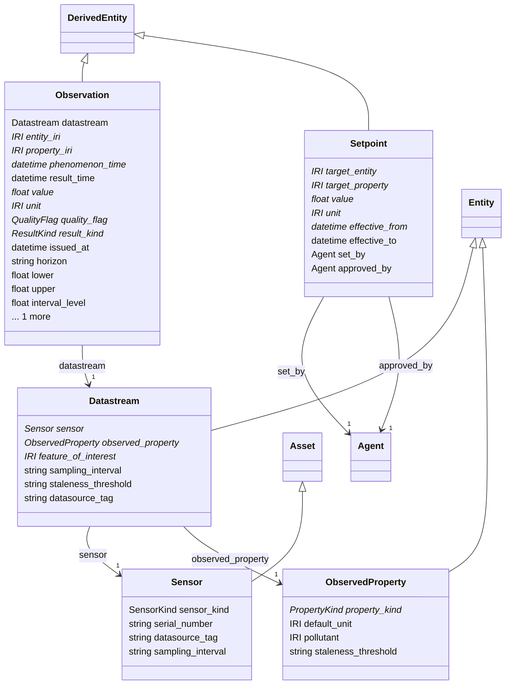

# observation

Sensors, observed properties, datastreams and the observations, forecasts and setpoints they carry. Aligned with W3C SOSA/SSN and OGC SensorThings. Observations are one tall table keyed by (entity, property, time) with the unit as an IRI; a Sensor is ATTACHED_TO the asset it measures (Edge), and a Datastream binds one sensor to one property of one feature of interest.

## Classes

| Class | Parent | Description |
| --- | --- | --- |
| `Datastream` | Entity | One sensor observing one property of one feature of interest over time; the unit of telemetry ingestion and the thing a staleness threshold applies to. |
| `Observation` | DerivedEntity | One value of one property for one entity at one time. Measurements, forecasts, simulation results and aggregates share this shape, distinguished by result_kind, so they can be compared in one query. was_generated_by is the ingestion job, forecast model version or simulation attempt. |
| `ObservedProperty` | Entity | A measurable property such as flow, depth or TSS concentration, with its physical kind and default unit. Pollutants from a SWMM model map here. |
| `Sensor` | Asset | A physical or virtual device that observes a property of an asset or area. Mounted on its feature of interest by an ATTACHED_TO edge. |
| `Setpoint` | DerivedEntity | A target value for a controllable property (pump speed, gate opening, tank level band) effective over a period. Agents only propose setpoints; set_by and approved_by record who made them real. |
