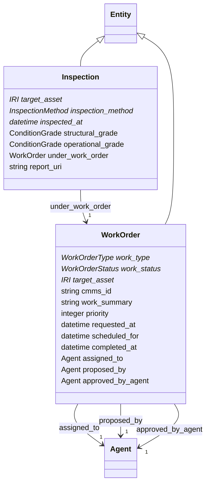

# operations

Work the utility does on its assets: work orders and inspections. Minimal on purpose; it exists so events can be resolved by real work (RESOLVED_BY) and inspection results can be evidence for events. Extended when CMMS data is onboarded.

## Classes

| Class | Parent | Description |
| --- | --- | --- |
| `Inspection` | Entity | A condition inspection of an asset with its grades; may be EVIDENCE_FOR an event such as a blockage. |
| `WorkOrder` | Entity | A unit of work on an asset. Events are RESOLVED_BY completed work orders. AI agents may propose work orders (proposed_by) but a person approves them. |
