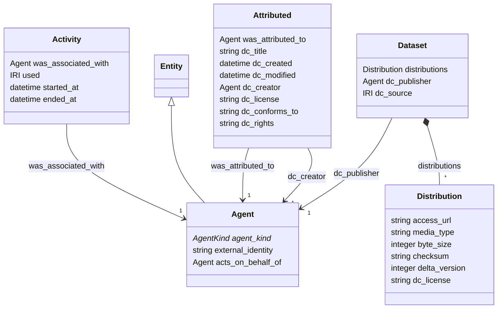

# provenance

Completes the PROV-O picture (who or what produced each derived thing) and adds Dublin Core descriptive metadata and DCAT alignment for dataset-like classes. PROV-O carries lineage, Dublin Core carries description, DCAT carries discoverability; nothing here duplicates what Unity Catalog or MLflow already record, it names it in a standard way.

## Classes

| Class | Parent | Description |
| --- | --- | --- |
| `Activity` |  | Mixin for activities (runs, attempts, state changes, pipeline executions). |
| `Agent` | Entity | Someone or something responsible for an entity or activity (PROV-O Agent). People, organisations, service principals, AI agents, ML model versions and other software all appear here so attribution is uniform. |
| `Attributed` |  | Mixin for anything PROV-attributed and Dublin-Core-described. |
| `Dataset` |  | Mixin for dataset-like entities that should be discoverable - training data, revisions, datastreams, the repo's own releases. |
| `Distribution` |  | One concrete form of a dataset-like entity - a Delta table at a version, a file in a Volume, a model artifact. |
