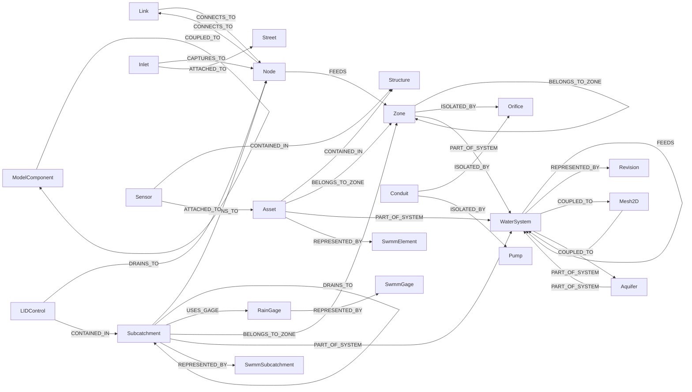
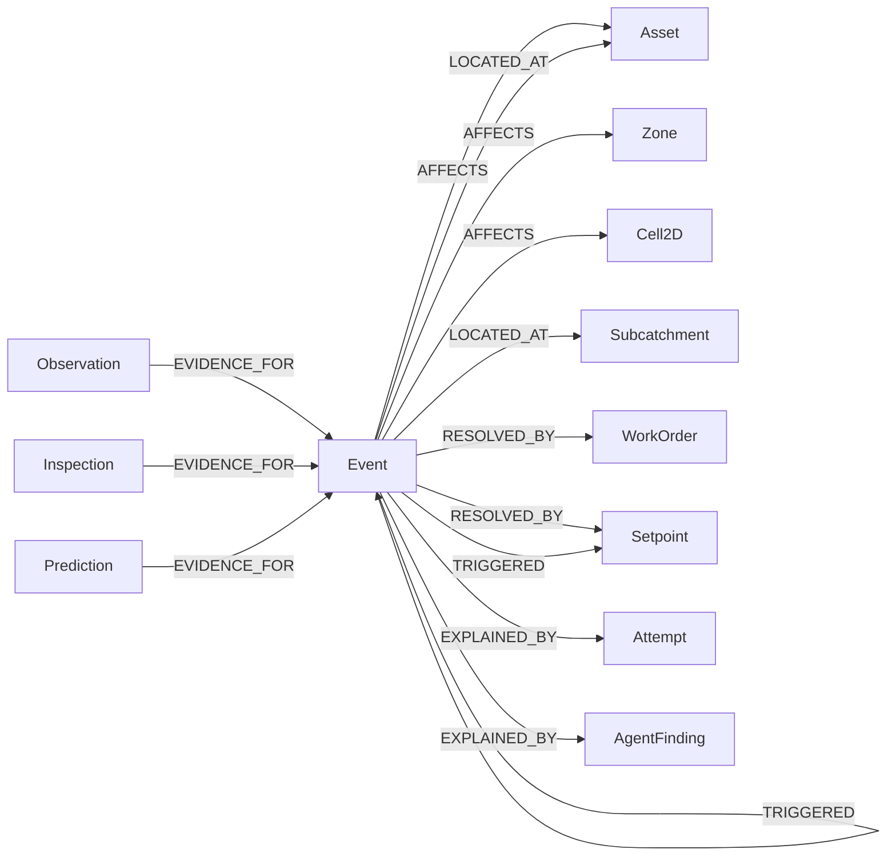

# Relations

Allowed (from → to) pairs per relation, from `schema/mappings/edge_domains.yaml`. These become SQL assertions on `topology.edge` and `event.event_link`.

## EdgeRelation

| Relation | From | To | Meaning |
| --- | --- | --- | --- |
| `CONNECTS_TO` | Link | Node | Hydraulic connectivity from the upstream end to the downstream end as modelled |
| `CONNECTS_TO` | Node | Link | Hydraulic connectivity from the upstream end to the downstream end as modelled |
| `DRAINS_TO` | Subcatchment | Node | Runoff routing from a Subcatchment to a Node or another Subcatchment |
| `DRAINS_TO` | Subcatchment | Subcatchment | Runoff routing from a Subcatchment to a Node or another Subcatchment |
| `DRAINS_TO` | LIDControl | Node | Runoff routing from a Subcatchment to a Node or another Subcatchment |
| `CAPTURES_TO` | Inlet | Node | An Inlet captures street flow to a Node |
| `USES_GAGE` | Subcatchment | RainGage | A Subcatchment receives rainfall from a RainGage |
| `CONTAINED_IN` | Asset | Structure | Structural containment such as a flow meter inside a chamber |
| `CONTAINED_IN` | LIDControl | Subcatchment | Structural containment such as a flow meter inside a chamber |
| `CONTAINED_IN` | Sensor | Structure | Structural containment such as a flow meter inside a chamber |
| `ATTACHED_TO` | Sensor | Asset | A device mounted on another asset such as a level sensor on a manhole |
| `ATTACHED_TO` | Inlet | Street | A device mounted on another asset such as a level sensor on a manhole |
| `BELONGS_TO_ZONE` | Asset | Zone | Membership of a derived sewershed or drainage area or CSO basin |
| `BELONGS_TO_ZONE` | Subcatchment | Zone | Membership of a derived sewershed or drainage area or CSO basin |
| `BELONGS_TO_ZONE` | Zone | Zone | Membership of a derived sewershed or drainage area or CSO basin |
| `FEEDS` | Node | Zone | A node or storage that supplies a zone or downstream system |
| `FEEDS` | WaterSystem | WaterSystem | A node or storage that supplies a zone or downstream system |
| `ISOLATED_BY` | Conduit | Orifice | A conduit or zone whose isolation depends on this gate or valve |
| `ISOLATED_BY` | Zone | Orifice | A conduit or zone whose isolation depends on this gate or valve |
| `ISOLATED_BY` | Conduit | Pump | A conduit or zone whose isolation depends on this gate or valve |
| `PART_OF_SYSTEM` | Asset | WaterSystem | Membership of a WaterSystem |
| `PART_OF_SYSTEM` | Subcatchment | WaterSystem | Membership of a WaterSystem |
| `PART_OF_SYSTEM` | Zone | WaterSystem | Membership of a WaterSystem |
| `PART_OF_SYSTEM` | Aquifer | WaterSystem | Membership of a WaterSystem |
| `PART_OF_SYSTEM` | Mesh2D | WaterSystem | Membership of a WaterSystem |
| `REPRESENTED_BY` | Asset | SwmmElement | The SwmmElement in a given Revision that models this asset |
| `REPRESENTED_BY` | Subcatchment | SwmmSubcatchment | The SwmmElement in a given Revision that models this asset |
| `REPRESENTED_BY` | RainGage | SwmmGage | The SwmmElement in a given Revision that models this asset |
| `REPRESENTED_BY` | WaterSystem | Revision | The SwmmElement in a given Revision that models this asset |
| `COUPLED_TO` | ModelComponent | ModelComponent | A HydroCouple exchange between two model components or domains |
| `COUPLED_TO` | WaterSystem | Mesh2D | A HydroCouple exchange between two model components or domains |
| `COUPLED_TO` | WaterSystem | Aquifer | A HydroCouple exchange between two model components or domains |

## EventLinkRelation

| Relation | From | To | Meaning |
| --- | --- | --- | --- |
| `AFFECTS` | Event | Asset | Asset or zone or cell or customer set impacted |
| `AFFECTS` | Event | Zone | Asset or zone or cell or customer set impacted |
| `AFFECTS` | Event | Cell2D | Asset or zone or cell or customer set impacted |
| `LOCATED_AT` | Event | Asset | The asset or location where it occurred |
| `LOCATED_AT` | Event | Subcatchment | The asset or location where it occurred |
| `EVIDENCE_FOR` | Observation | Event | An observation, anomaly or report supporting this event (link from evidence to event) |
| `EVIDENCE_FOR` | Inspection | Event | An observation, anomaly or report supporting this event (link from evidence to event) |
| `EVIDENCE_FOR` | Prediction | Event | An observation, anomaly or report supporting this event (link from evidence to event) |
| `EVIDENCE_FOR` | Event | Event | An observation, anomaly or report supporting this event (link from evidence to event) |
| `CAUSED_BY` | Event | Event | Another event or condition that caused this one |
| `PART_OF` | Event | Event | Child event of a larger one (e.g. flooding within a storm) |
| `RESOLVED_BY` | Event | WorkOrder | Work order or control action that resolved it |
| `RESOLVED_BY` | Event | Setpoint | Work order or control action that resolved it |
| `TRIGGERED` | Event | Setpoint | A control action or alarm this event triggered |
| `TRIGGERED` | Event | Event | A control action or alarm this event triggered |
| `EXPLAINED_BY` | Event | Attempt | A model attempt or finding that explains it |
| `EXPLAINED_BY` | Event | AgentFinding | A model attempt or finding that explains it |
