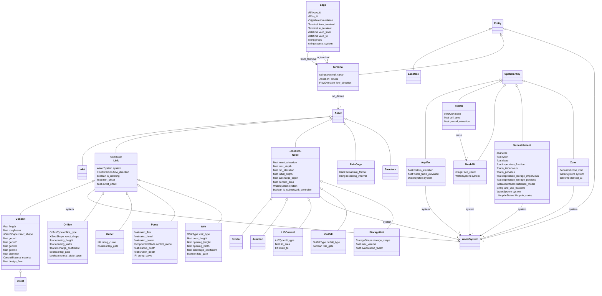

# topology

Physical assets of a drainage, sewer or stormwater network and how they connect, following SWMM/OpenSWMM element semantics. Connectivity, containment, attachment, drainage and zone membership live in Edge rows (one directed graph), not on the assets, following the Esri Utility Network associations pattern. Devices with more than one port connect through Terminals so traces are directionally correct. Each asset is linked to its SWMM model element in a given Revision by a REPRESENTED_BY edge.

## Classes

| Class | Parent | Description |
| --- | --- | --- |
| `Aquifer` | SpatialEntity | A groundwater unit beneath subcatchments or a 2D mesh; exchanges with the drainage network. |
| `Cell2D` | SpatialEntity | One cell of a Mesh2D. |
| `Conduit` | Link | A gravity sewer, force main, culvert or open channel with a cross-section and roughness. |
| `Divider` | Node | A node that splits inflow between two downstream links by rule, weir or tabular relationship. |
| `Edge` |  | One directed, typed relationship between two entities. All connectivity, drainage routing, containment, attachment, zone membership and model representation live here. |
| `Inlet` | Asset | A curb, grate or combination inlet that captures street flow; CAPTURES_TO a Node and is ATTACHED_TO a Street. |
| `Junction` | Node | A manhole, catch basin or pipe junction with no storage volume beyond its shaft. |
| `LIDControl` | Node | A low-impact-development control (bioretention, permeable pavement, green roof, ...). Modelled as a storage node with its own outlet controls per OpenSWMM 6; placed inside a Subcatchment by a CONTAINED_IN edge. |
| `LandUse` | Entity | A land-use category used for pollutant buildup and washoff. |
| `Link` | Asset | A component that conveys flow between two nodes. Endpoints are asserted by CONNECTS_TO edges, not stored here, so the graph has one source of truth. SWMM link. |
| `Mesh2D` | SpatialEntity | A finite-volume surface mesh for 2D overland flow coupled to the 1D network. |
| `Node` | Asset | A point in the network where links meet or where flow enters, leaves or is stored. SWMM node. |
| `Orifice` | Link | A side or bottom orifice regulating flow between nodes; may be gated. |
| `Outfall` | Node | A terminal node where flow leaves the system to a receiving water; defines a sewershed when used as a subnetwork controller. |
| `Outlet` | Link | A flow regulator defined by a rating curve. |
| `Pump` | Link | A pump; connects through SUCTION and DISCHARGE terminals. |
| `RainGage` | Asset | A rain gage or the rainfall record it provides; Subcatchments reference it by USES_GAGE edges. |
| `StorageUnit` | Node | A wet well, detention basin, retention pond or tank with a depth-area or depth-volume relationship. |
| `Street` | Conduit | A street cross-section conveying surface flow; inlets along it capture flow to the drainage network. |
| `Structure` | Asset | A chamber, vault, pump station building or other enclosure that contains devices. |
| `Subcatchment` | SpatialEntity | A land area whose runoff drains to one outlet node or subcatchment (DRAINS_TO edge). Hydrologic parameters mirror SWMM. |
| `Terminal` | Entity | A named port on a device through which it connects. Required on pumps, multi-port regulators and storage so flow direction is unambiguous. |
| `WaterSystem` | Entity | A hydraulically connected drainage, sewer or stormwater network operated as one system, usually one SWMM model. |
| `Weir` | Link | A transverse, side-flow, V-notch, trapezoidal or roadway weir. |
| `Zone` | SpatialEntity | A derived grouping of nodes, links and subcatchments such as a sewershed, drainage area or CSO basin. Membership is computed from subnetwork controllers and connectivity, then materialised with a derived_at timestamp; never hand-edited. |
