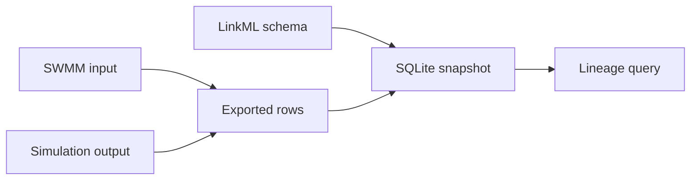

# Trace a result to its source

A SQLite release brings a SWMM result together with the model revision, source record and output artifact that support it. Use the lineage view to inspect all three for a reported depth.

## How the snapshot is built



Input and result records populate the tables derived from LinkML. The lineage view joins evidence for each observation.

## Build the example

Install the development extra, then run `make sqlite` in the checkout. Open the resulting snapshot with `sqlite3 dist/water-ontology.sqlite`. The committed drainage example includes the model and the exported rows, so reproducing this query uses the retained run.

## Query a depth observation

```sql
SELECT entity_iri, value, unit, source_section, source_line,
       revision_iri, attempt_iri, output_sha256
FROM analysis__result_lineage
WHERE property_iri = 'wsys:prop/depth'
ORDER BY value DESC
LIMIT 1;
```

| Field | How to use it |
| --- | --- |
| `source_section`, `source_line` | Locate the object in the original input. |
| `revision_iri`, `attempt_iri` | Identify the input revision and the execution that produced the result. |
| `output_sha256` | Match the value to its retained output artifact. |

> **Keep the output artifacts.** Distribute the matching artifact directory with the snapshot when readers need to open the binary results.

In the committed drainage example this query selects outfall **O1**, with a depth of **1.120997 m**. Its input record is in section `OUTFALLS` on line 106. A fresh execution has its own attempt identifier.

See [SWMM and SQLite](swmm-sqlite.md) for release validation, restoring a previous snapshot and the separate Delta publication checks.
